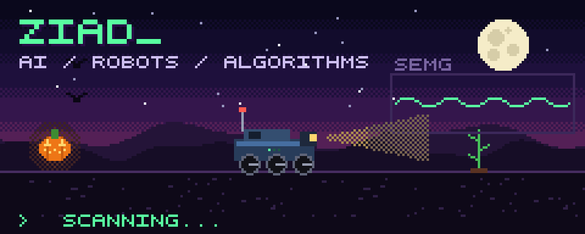

<div align="center">



# Ziad Emad Salem

**Applied AI & Machine Learning · Computer Vision · Robotics & Embedded Systems · Competitive Programming**

STEM High School Senior (6th of October, Egypt) · ACPC Top 31 National Finalist · ISEF Egypt Finalist · NASA Space Apps Galactic Problem Solver

[](https://portfolio-2kkf.vercel.app/)
[](https://orcid.org/0009-0001-7460-1592)
[](#)

</div>

---

### Overview

I build systems that bridge **machine learning, physical hardware, and algorithmic problem solving**—from plant bio-signal and vision pipelines to wireless inspection rovers, real-time AI agents, and standalone software.

- **AI, Vision & Bio-Signals:** Deep learning models (1D/2D CNNs), real-time object detection (`RF-DETR`, `SuperVision`, `OpenCV`, `MediaPipe`), and sensor/electrophysiology pipelines.
- **Robotics & Embedded Systems:** `ESP32` / `ESP32-CAM`, `Arduino`, `Raspberry Pi`, motor control, multi-sensor telemetry, power distribution, and wireless control interfaces.
- **Systems, Agents & Algorithms:** `Python`, `C++`, `FastAPI`, `LangChain`, `n8n`, `LiveKit Cloud`, `Pygame`, and competitive programming (`Fenwick Trees`, `Sparse Tables`, `Prefix Sums`, `Graphs`, `Trees`, `DP`).

---

### Selected Work

| Project | Domain | Summary |
| :--- | :--- | :--- |
| **Project AETHER ("The Pytho Sentry")** | Agricultural AI & Bio-Signals | Early crop pest and stress detection combining plant electrophysiology (sEMG), VOC sensor arrays, and 1D/2D CNNs. *ISEF Egypt National Finalist.* |
| **6WD Wireless Pipe Inspection Rover** | Robotics & Embedded | Six-wheeled confined-space inspection rover with `ESP32-CAM` live video, dual `L298N` drivers, `MQ-2` & ultrasonic sensors, pan/tilt servo, `18650` power system, and web control. |
| **The Dark Night** | Game Engineering & Desktop | Halloween-themed 2D action-platformer built from scratch in `Python` and `Pygame` with custom physics and cross-platform builds. |
| **Real-Time Vision & AI Workflows** | Computer Vision & Backend | Low-latency local object detection with `RF-DETR` + `SuperVision`, paired with agentic/automation pipelines in `FastAPI`, `LangChain`, `n8n`, and `LiveKit Cloud`. |

---

### Stack

```text
Languages      Python (3.12) · C++ · C / Arduino · HTML / CSS / JS · Markdown
AI & Vision    PyTorch · Scikit-Learn · OpenCV · MediaPipe · RF-DETR · SuperVision
Data & Viz     NumPy · Pandas · Matplotlib · Seaborn
Backend & AI   FastAPI · LangChain · n8n · LiveKit Cloud · OpenRouter API
Hardware       ESP32 / ESP32-CAM · Arduino Uno · Raspberry Pi · Sensors & Motor Drivers
Algorithms     Fenwick Trees · Sparse Tables · Prefix Sums · Graphs · Trees · DP
Desktop & Env  Pygame · Tkinter · Linux · Windows · Git & GitHub
